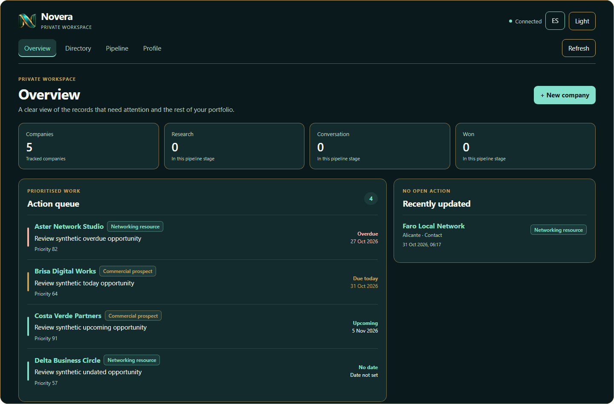
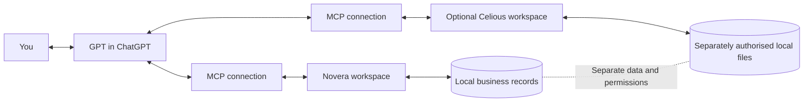
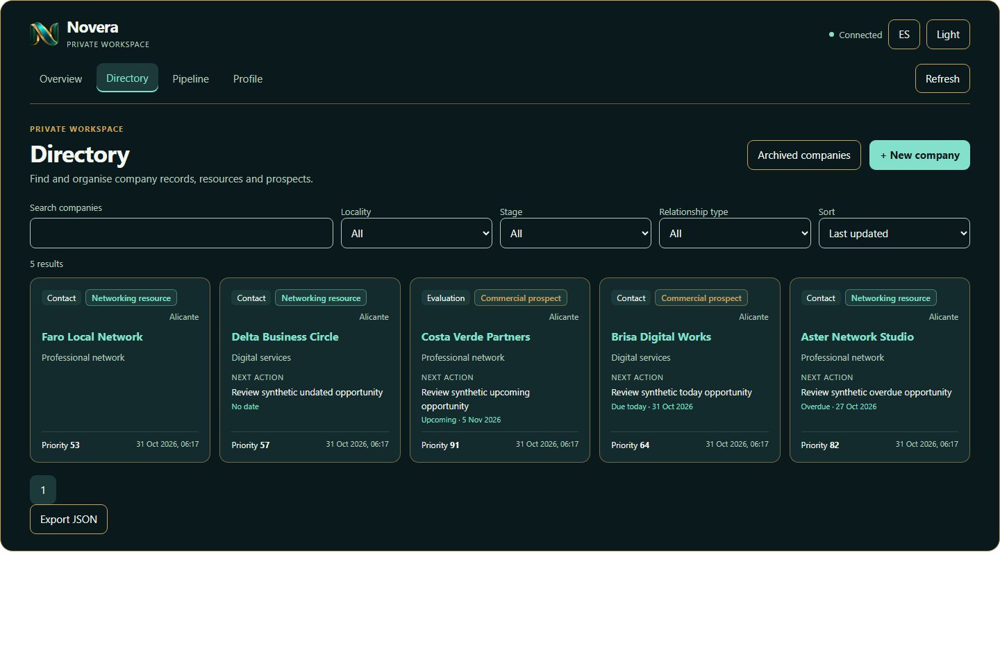
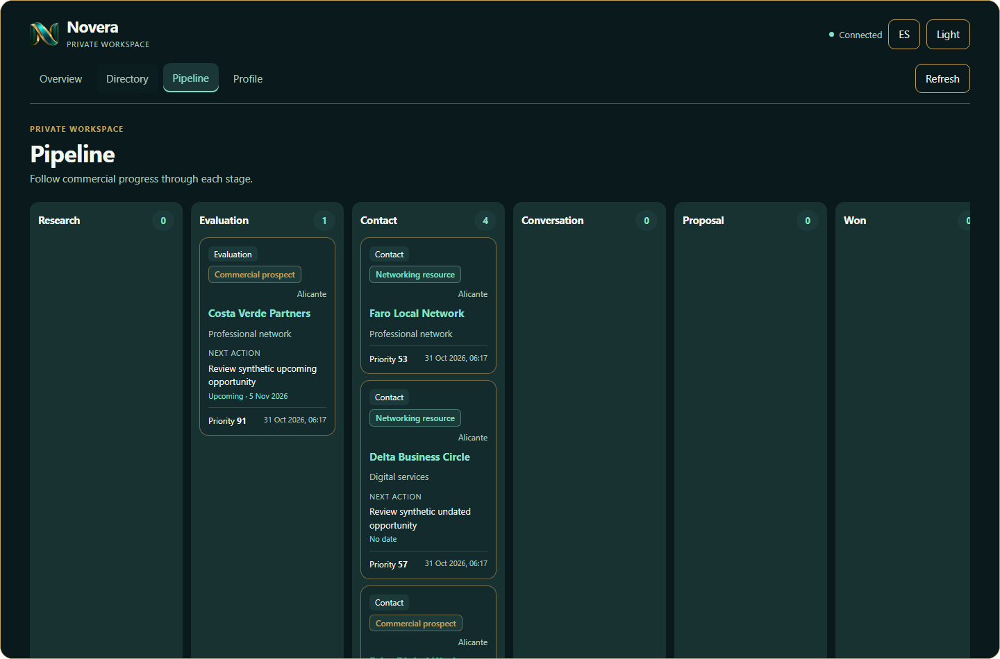
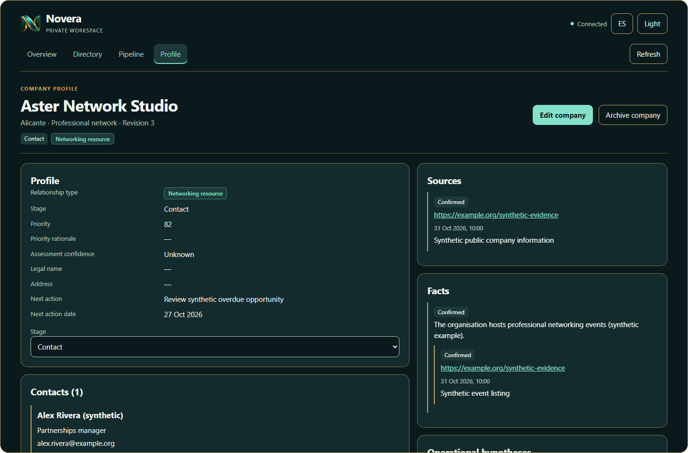
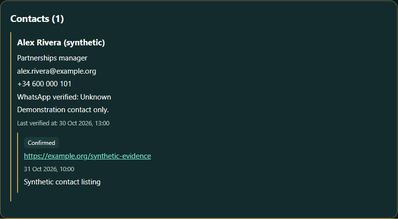
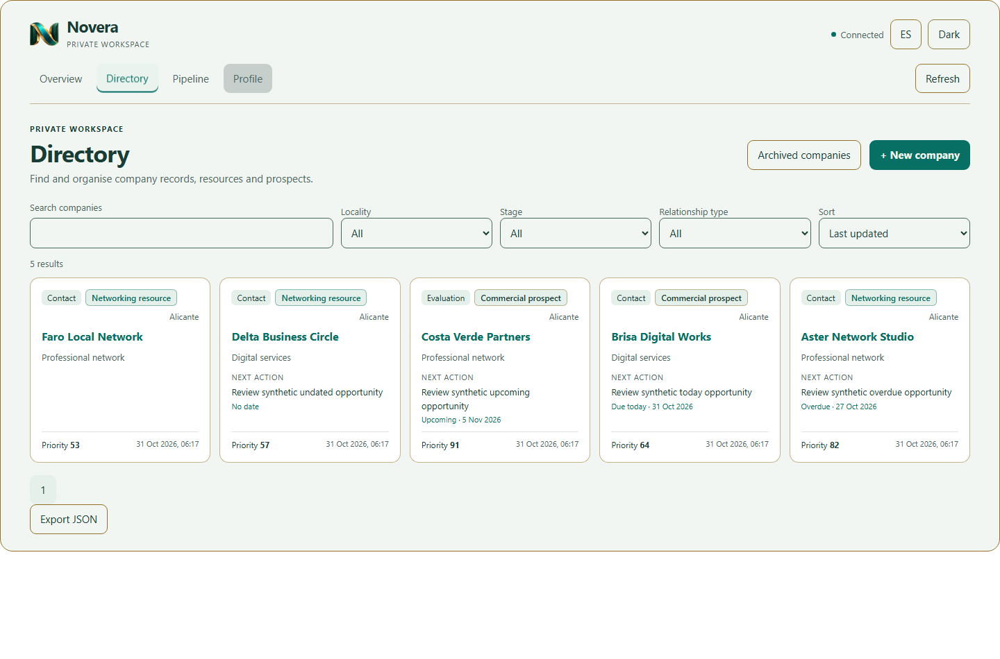
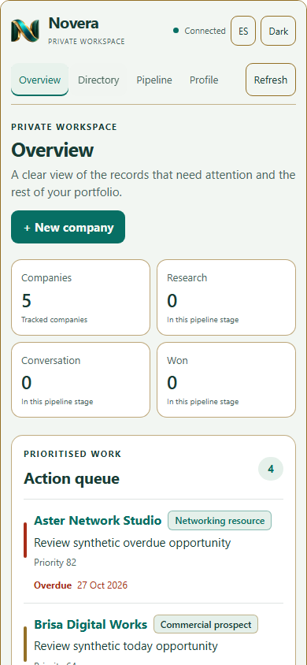
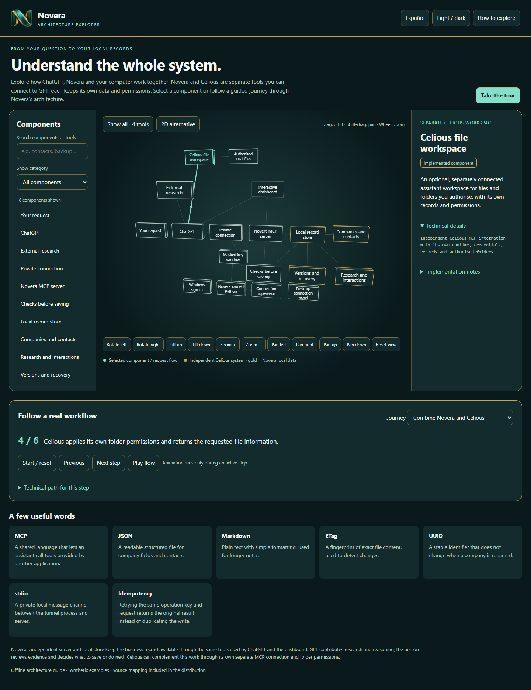

# Novera

*Research, relationships and business intelligence, connected to GPT.*

Novera gives professionals one local-first workspace for company research, professional relationships, supporting evidence, commercial progress and next actions. Connected to ChatGPT through MCP, it lets an assistant retrieve reviewed business context across conversations while the user remains in control of what is saved and what happens next.

[**Explore the interactive Novera experience**](https://ezequiel-gb.github.io/Novera/) · [English architecture explorer](https://ezequiel-gb.github.io/Novera/docs/architecture-explorer/Novera-Architecture-Explorer-EN.html) · [Explorador de arquitectura en español](https://ezequiel-gb.github.io/Novera/docs/architecture-explorer/Novera-Architecture-Explorer-ES.html)

## Explore how it works

The bilingual architecture explorer is a self-contained, interactive guide. Select parts of the system, move around the spatial diagram, follow guided business journeys, and switch to an accessible 2D view. It works in a modern browser without a Novera installation, account, API key or live service.

[**Open the English explorer**](docs/architecture-explorer/Novera-Architecture-Explorer-EN.html) · [**Abrir el explorador en español**](docs/architecture-explorer/Novera-Architecture-Explorer-ES.html)

## What Novera helps organise

- Company and professional-contact records.
- Research notes with supporting sources and clear distinctions between evidence, hypotheses and unknowns.
- Commercial stages, interaction history and dated next actions.
- Reviewed context that can be retrieved in a later assistant conversation.
- Version-checked changes and recoverable local records.

GPT can help interpret information, compare opportunities and prepare possible next steps. The person reviews the evidence, decides what to retain and makes business decisions. Novera keeps the selected information organised beyond a single chat.

## How GPT, MCP, Novera and Celious work together

**GPT** helps research and reason over information available in the conversation. **MCP** is the structured connection that lets ChatGPT discover Novera's tools, request an operation and receive its result. **Novera** stores the business records and makes them available through its dashboard and tools.

**Celious** is an optional, independent local-workspace integration. When separately connected, it can work with files in folders the user authorises. GPT can consider information from both integrations in one workflow, while Novera and Celious keep separate permissions, credentials and data stores.

## Practical business workflows

### Business development

Research a potential organisation, review its sources, record relevant contacts and decide on a next action. The evidence and decision stay with the company record for future work.

### Commercial research continuity

Return days later and ask GPT to retrieve a saved company, its research and previous notes through Novera, rather than reconstructing context from an old conversation.

### Client relationships

Keep professional contacts, dated interactions and pipeline progress together, then review the history before planning the next conversation.

### Existing documents

When both integrations are connected, GPT can use Celious to access an authorised document, compare it with related Novera context, and help prepare a reviewed update. Each product retains its own access controls and information store.

### Opportunity evaluation

Compare organisations using sourced observations and clearly marked hypotheses. GPT can help weigh the available context; the user decides where to focus.

## Application preview

All images below show the real Novera interface with synthetic demonstration records.

| Overview | Directory | Pipeline |
|---|---|---|
|  |  |  |

| Company profile | Contacts and sources | Interaction history |
|---|---|---|
|  |  |  |

| Light theme | Mobile layout | Guided explorer workflow |
|---|---|---|
|  |  |  |

## Novera at a glance

- **A focused workspace:** company records, contacts, evidence, interactions, pipeline and next actions.
- **A connected assistant:** ChatGPT can request saved context and explicitly requested record operations through MCP.
- **Local-first records:** business information persists in Novera's dedicated local storage, independently of Celious and chat history.
- **Human-directed work:** people review information and choose which records and actions to approve.
- **A clear architecture:** the interactive explorer explains the working system in English and Spanish.

## Publication

This repository is the public Novera product showcase. Its screenshots use synthetic records; it contains no live company data or production credentials. The complete application source is maintained separately in the private `Novera-Core` repository.

The interactive site is designed for GitHub Pages and uses relative paths. To preview locally, open `index.html` in a Chromium-based browser or serve the repository root with a static file server.
